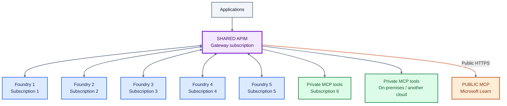
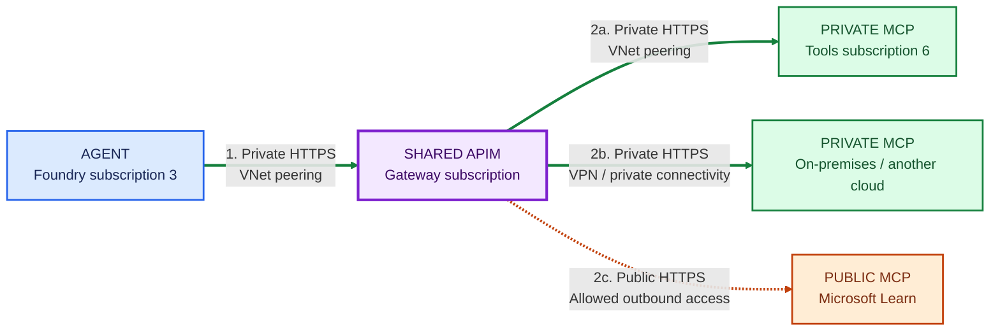

# AI Landing Zone Architecture

**One shared APIM gateway, five Foundry subscriptions, and a shared tools
subscription.** Agents access private and public tools through the same gateway.

These diagrams show the target architecture, not a validated deployment.

## Color key

| Color | Meaning |
|---|---|
| Purple | The single shared APIM gateway |
| Blue | Foundry instances and agents |
| Green | Private MCP tools |
| Orange | Public MCP tools, such as Microsoft Learn |
| Gray | Applications |

## 1. Where everything lives

Each box names its subscription. The green tools box is a separate, sixth
workload subscription; APIM has its own subscription.

**Read it as:** applications call APIM to reach agents; agents call that same
APIM to reach tools or supported model APIs. The arrows show API relationships,
not automatic routing of every Foundry-internal call.

## 2. How an agent reaches tools

Follow one agent from subscription 3. All five Foundry environments use the
same pattern.

**Solid green lines = private traffic. Dashed orange line = public HTTPS.**
Responses return over the same connections and are omitted.

**Step 1:** the agent calls an APIM endpoint. **Step 2:** APIM calls the chosen
tool backend; 2a, 2b, and 2c are alternatives, not sequential steps.

The agent does not need a direct connection to each tool network. APIM makes
the backend connection. Microsoft Learn remains a public service even though
the agent reaches APIM privately.

## Two deployment options, same diagrams

The purple box is always one APIM instance. Choose one networking configuration:

| Option | How callers reach APIM privately | How APIM reaches private backends |
|---|---|---|
| **Premium v2** | Injected gateway private IP | VNet injection |
| **Standard v2** | Inbound private endpoint; public gateway access disabled after establishing the private endpoint | Outbound VNet integration |

## Details intentionally left out of the diagrams

- **Connectivity:** this example uses direct peering between the gateway VNet
  and each Foundry/tools VNet. If enterprise policy requires hub-firewall
  inspection, use explicitly configured hub routing instead.
- **DNS and access:** private DNS, network rules, backend authorization, and
  client endpoint configuration are still required. Peering alone does not
  force requests through APIM or prevent bypass.
- **Managed agents:** the Foundry-managed MCP data-proxy-to-private-APIM path
  requires validation with tool discovery and invocation. The solid traffic
  arrows express the target flow, not verified runtime compatibility.
- **Model calls:** custom code can use APIM endpoints where supported.
  Foundry-managed internal model calls do not automatically traverse APIM.
- **Infrastructure:** Storage, Cosmos DB, and AI Search dependency traffic is
  outside the API-gateway flow.
- **Public tools:** private APIM ingress does not disable outbound internet
  access. Explicitly configure supported egress controls and MCP proxy behavior
  for the public backend.

## References

- [Foundry template 19: private network agent tools](https://github.com/microsoft-foundry/foundry-samples/tree/main/infrastructure/infrastructure-setup-bicep/19-private-network-agent-tools).
- [AI Landing Zones](https://azure.github.io/AI-Landing-Zones/).
- [AI Gateway / Citadel Governance Hub](https://github.com/Azure-Samples/ai-hub-gateway-solution-accelerator/).
- [APIM Premium v2 VNet injection](https://learn.microsoft.com/azure/api-management/inject-vnet-v2).
- [APIM inbound private endpoints](https://learn.microsoft.com/azure/api-management/private-endpoint).
- [Foundry public and private MCP endpoints](https://learn.microsoft.com/azure/foundry/agents/how-to/tools/model-context-protocol#public-and-private-mcp-server-endpoints).
