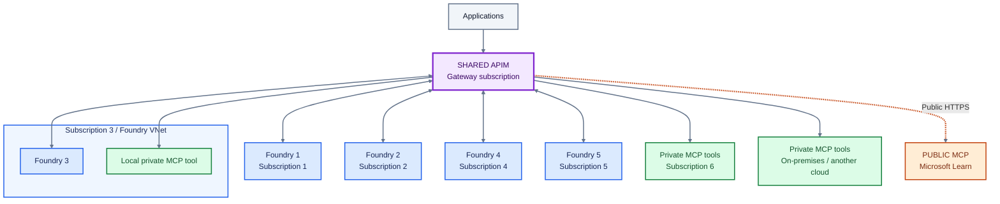
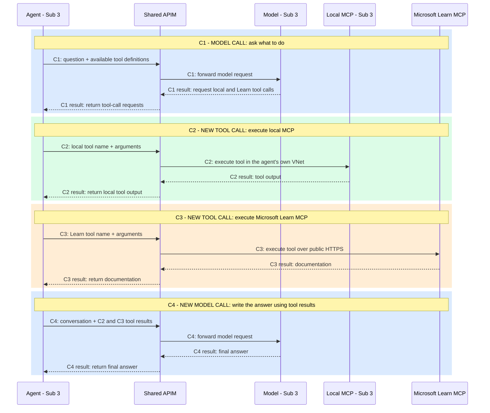

# AI Landing Zone Architecture

**One shared APIM gateway, five Foundry subscriptions, and a shared tools
subscription.** Agents access private and public tools through the same gateway.

An existing **platform connectivity subscription** provides the network hub,
firewall, DNS, and connections to remote networks. It is separate from the
seven AI subscriptions above.

These diagrams show the target architecture, not a validated deployment.

## Color key

| Color | Meaning |
|---|---|
| Purple | The single shared APIM gateway |
| Blue | Foundry instances and agents |
| Green | Private MCP tools |
| Orange | Public MCP tools, such as Microsoft Learn |
| Teal | Shared enterprise network hub and firewall |
| Gray | Applications |

## 1. Where everything lives

The subscription 3 group contains both Foundry and a local MCP tool in the same
VNet. Shared private tools live in subscription 6; APIM has its own subscription.
This is the **logical API view**: network and firewall hops are intentionally
omitted here and shown in diagram 2.

**Read it as:** applications call APIM to reach agents; agents call that same
APIM to reach tools or supported model APIs. The arrows show API relationships,
not automatic routing of every Foundry-internal call.

## 2. How traffic crosses the enterprise network

**These are two different API calls, not branches of one request.** Follow each
row from left to right. The examples use hub-firewall routing, reflecting the
Visio's hub and UDR labels.

Each row repeats the same physical firewall to show its two traversal points
without crossing lines. Both rows use the **same single APIM instance**.
Green arrows are private traffic; responses follow the connections back and
are omitted.

### C1: a model call

```mermaid
flowchart LR
    Agent["AGENT<br/>Subscription 3"]
    FW1["HUB FIREWALL<br/>First pass"]
    APIM["SHARED APIM<br/>Model API"]
    FW2["SAME HUB FIREWALL<br/>Second pass"]
    Model["MODEL<br/>Subscription 3"]

    Agent -->|"C1: model request"| FW1
    FW1 -->|"C1: to APIM"| APIM
    APIM -->|"C1: forward to model"| FW2
    FW2 -->|"C1: to model"| Model

    classDef gateway fill:#F3E8FF,stroke:#7E22CE,stroke-width:3px,color:#3B0764
    classDef foundry fill:#DBEAFE,stroke:#2563EB,stroke-width:2px,color:#172554
    classDef network fill:#CCFBF1,stroke:#0F766E,stroke-width:2px,color:#134E4A

    class APIM gateway
    class Agent,Model foundry
    class FW1,FW2 network
    linkStyle default stroke:#15803D,stroke-width:3px
```

All four arrows belong to **C1**, the same logical model call. APIM opens a
backend connection to forward it. No MCP tool is executed by this request.
The model may return a request for the agent runtime to execute a tool.

### C2: a separate local-tool call

```mermaid
flowchart LR
    Agent["AGENT<br/>Subscription 3"]
    FW1["HUB FIREWALL<br/>First pass"]
    APIM["SAME SHARED APIM<br/>Local MCP API"]
    FW2["SAME HUB FIREWALL<br/>Second pass"]
    Local["LOCAL MCP TOOL<br/>Subscription 3 / Agent's VNet"]

    Agent -->|"C2: tool request"| FW1
    FW1 -->|"C2: to APIM"| APIM
    APIM -->|"C2: forward to tool"| FW2
    FW2 -->|"C2: back to agent's VNet"| Local

    classDef gateway fill:#F3E8FF,stroke:#7E22CE,stroke-width:3px,color:#3B0764
    classDef foundry fill:#DBEAFE,stroke:#2563EB,stroke-width:2px,color:#172554
    classDef privateTool fill:#DCFCE7,stroke:#15803D,stroke-width:2px,color:#14532D
    classDef network fill:#CCFBF1,stroke:#0F766E,stroke-width:2px,color:#134E4A

    class APIM gateway
    class Agent foundry
    class Local privateTool
    class FW1,FW2 network
    linkStyle default stroke:#15803D,stroke-width:3px
```

All four arrows belong to **C2**, a new call made by the agent runtime.
The agent and local tool share subscription 3 and its VNet, but this request
goes out through APIM and back. There is no direct agent-to-tool call shown.

Other tools use their own separate calls:

| Destination | APIM's backend route in this design |
|---|---|
| Shared private MCP in subscription 6 | Hub firewall to the shared tools spoke |
| Private MCP on-premises or in another cloud | Hub firewall and configured private connectivity |
| Public Microsoft Learn MCP | Hub firewall to the public endpoint over allowed outbound HTTPS |

The firewall controls network traffic; APIM controls API access and policies.
Workload spokes peer with the hub, with explicit routes and firewall rules:
peering alone is not transitive. Central DNS, the other four Foundry spokes,
and subscription boundaries around APIM/firewall are omitted from these
single-call views to keep them readable.

## 3. Model calls and tool calls are separate requests

This example shows one possible agent workflow: ask a model, execute two tools,
then ask the model to produce an answer using the results. Not every question
requires tools, and each invocation of a tool is a separate request.

**Read from top to bottom. C1 -> C2 -> C3 -> C4 is the execution order in
this example.** A repeated ID means another hop or response within the same
logical call; a new ID means a separate call. Tools can also run in parallel
when supported, but this example deliberately shows sequential execution.

**This is the target flow for agent code that supports APIM-configured model
and tool endpoints.** It does not imply that Foundry-managed internal model
calls automatically use APIM. The managed MCP path still needs validation.
Firewall hops are omitted here; diagram 2 shows the network path.

The **agent runtime** executes the tool calls requested by the model. APIM
routes and governs each request independently. MCP discovery, session setup,
and other protocol messages are omitted so this view focuses on the separate
model calls and tool invocations.

## Two deployment options, same diagrams

The purple box is always one APIM instance. Choose one networking configuration:

| Option | How callers reach APIM privately | How APIM reaches private backends |
|---|---|---|
| **Premium v2** | Injected gateway private IP | VNet injection |
| **Standard v2** | Inbound private endpoint; public gateway access disabled after establishing the private endpoint | Outbound VNet integration |

These are **alternatives**, not two APIM instances deployed together. Both
must be configured to use the selected hub-routing design. For Standard v2,
the private endpoint handles inbound traffic and the integration subnet handles
outbound traffic; they are distinct networking components.

## Template 19: included versus additional work

This inventory covers the upstream template 19 `main.bicep`, its referenced
modules, and the accompanying examples, reviewed on October 22, 2026. The
upstream `main` branch can change. **The complete architecture above is an
extension of template 19, not its default deployment.**

### Included in the core infrastructure deployment

| Component | What template 19 provides |
|---|---|
| Foundry account | Creates an AI Services / Foundry account with public network access disabled and local authentication disabled. |
| Foundry project | Creates a project with a system-assigned managed identity. |
| Model deployment | Deploys one parameter-selected model with configurable model name, version, SKU, and capacity. |
| Agent Service setup | Configures account/project capability hosts and connections to the customer-managed dependencies. This is infrastructure setup, not deployment of your agent application. |
| Customer-owned VNet | Creates a VNet or references an existing VNet. It does not use the Microsoft-managed VNet option. |
| Three subnets | Agent subnet, private endpoint subnet, and MCP/tool-hosting subnet; includes the required delegations for the template's subnet configuration. |
| Existing-subnet reuse | Can reference existing subnet resource IDs without modifying those subnets, preserving externally managed route tables, NSGs, and delegations. |
| Azure Storage | Creates or reuses the storage account used by Agent Service, with related connections and role assignments. |
| Cosmos DB | Creates or reuses the Agent Service Cosmos DB dependency, with related connections and role assignments. Newly created Cosmos DB is single-region. |
| Azure AI Search | Creates or reuses the Search service, with related connections and role assignments. |
| Private endpoints and DNS | Creates private endpoints and associated DNS configuration for its supported dependencies. Existing private DNS zones can be referenced; the README requires you to pre-link referenced zones to the VNet. |
| Key Vault | Enabled by default; can create a vault or use an existing one for private CA trust, with private endpoint/DNS and Foundry identity access. Certificate onboarding is a separate step. |
| Azure Container Registry | Enabled by default; creates a Premium registry with a private endpoint and project identity pull permissions. Can be disabled. |
| Monitoring | Creates Application Insights, Log Analytics, the Foundry telemetry connection, and Azure Monitor Private Link Scope (AMPLS) with private ingestion connectivity. |
| Supporting identity permissions | Creates the system-assigned identities and resource/data-plane role assignments used by this Foundry setup. These are not your APIM caller/backend authorization policies. |

**Do not interpret "private endpoints included" as "every public endpoint and
authentication method is disabled."** Individual resources have different
defaults. For example, the inspected Key Vault module uses public network
access enabled with firewall default-deny and Azure-services bypass;
Application Insights public querying remains enabled; AI Search allows Entra
or API-key authentication. Review the actual resource properties against your
enterprise policies.

### Provided as separate examples or follow-up steps

These are in the sample folder but are **not automatically deployed by the
core `main.bicep` deployment**.

| Item | What is available separately |
|---|---|
| MCP server hosting | README deployment steps and a Dockerfile example for deploying a server on Container Apps. The core template creates the subnet, not a running MCP server or Container Apps environment. |
| OpenAPI tool | Example server code and Dockerfile. |
| Azure Function tool | Example application, OpenAPI description, and separate deployment files. Its documented private-endpoint limitations still apply. |
| A2A tool/agent server | Example server code and Dockerfile. |
| Agent tests | Scripts and a testing guide for exercising the environment; not a production agent application or automated acceptance of our APIM design. |
| Additional projects | Separate `add-project` Bicep entry point and parameter file. |
| Private certificate trust | Instructions for CA certificate onboarding; the core vault deployment alone does not complete trust setup. |

### Not included: additions needed for our proposed architecture

| Component or behavior | Additional work required |
|---|---|
| APIM, either SKU | Deploy the single shared gateway. Neither Premium v2 nor Standard v2 APIM is deployed or connected by template 19. |
| APIM networking | Configure Premium v2 injection, or Standard v2 private endpoint plus outbound integration and disabled public gateway access. |
| APIM API configuration | Create agent, model, and MCP APIs, backend definitions, policies, caller authorization, backend credentials/identities, and gateway diagnostics. |
| Enterprise connectivity hub | Create or reuse the platform hub VNet and connectivity subscription. |
| Azure Firewall | Create or reuse the firewall and define network/application rules and any required egress allowlists. |
| Peering and routed traffic | Configure hub/spoke peering, UDRs, route tables, subnet associations, return paths, and private-endpoint routing as needed. Preserving an existing route table does not create or validate its routes. |
| Custom NSG rules | Supply enterprise NSGs and traffic restrictions; the core VNet/subnet modules do not deploy the firewall/NSG enforcement design shown here. |
| Enterprise DNS forwarding | Configure DNS Private Resolver or DNS servers, forwarding rules, and cross-VNet name resolution. Private DNS zone creation is not a complete enterprise DNS design. |
| Remote network access | Configure VPN, ExpressRoute, or other connectivity to on-premises and other-cloud tools. |
| Developer/client private access | Supply VPN, ExpressRoute, Bastion/jump-host access, or another supported way to reach the private environment. |
| Five Foundry subscriptions | Provision the subscriptions separately and deploy/configure each Foundry environment. Template 19 is not a multi-subscription landing-zone orchestrator. |
| Shared tools subscription | Provision the separate tools environment, deploy its MCP servers, and connect it to the gateway network. |
| Public Microsoft Learn MCP through APIM | Register/configure the public MCP backend, gateway API, and supported outbound controls. |
| All-through-APIM behavior | Configure supported agent clients to use APIM endpoints and restrict bypass appropriately. The template does not redirect internal model calls or tool calls through APIM. |
| Production applications | Supply agent code/definitions, app frontends, business-specific tools, knowledge ingestion, and application deployment pipelines. |
| Wider governance stack | Add API Center, gateway usage ingestion/reporting, and enterprise Defender/Purview/Policy configuration as required. These are not provisioned as the full governance architecture by template 19. |
| End-to-end verification | Prove the selected APIM SKU, firewall routing, DNS, managed MCP discovery/invocation, and intended model-call behavior together. |

**In short:** template 19 supplies the private Foundry foundation. APIM,
enterprise firewall networking, and the shared multi-subscription gateway
behavior are additions.

Inventory sources:
[main deployment](https://github.com/microsoft-foundry/foundry-samples/blob/main/infrastructure/infrastructure-setup-bicep/19-private-network-agent-tools/main.bicep),
[modules](https://github.com/microsoft-foundry/foundry-samples/tree/main/infrastructure/infrastructure-setup-bicep/19-private-network-agent-tools/modules-network-secured),
and [README and examples](https://github.com/microsoft-foundry/foundry-samples/tree/main/infrastructure/infrastructure-setup-bicep/19-private-network-agent-tools).

## Details intentionally left out of the diagrams

- **Connectivity:** diagram 2 selects hub-firewall routing. This requires
  SKU-supported route configuration, symmetric return paths, and firewall
  rules, including private-endpoint routing configuration where applicable.
  Direct peering to the gateway spoke remains a simpler alternative when
  central inspection is not required, but is not the path shown here.
- **DNS and access:** private DNS, network rules, backend authorization, and
  client endpoint configuration are still required. Peering alone does not
  force requests through APIM or prevent bypass.
- **Managed agents:** the Foundry-managed MCP data-proxy-to-private-APIM path
  requires validation with tool discovery and invocation. The solid traffic
  arrows express the target flow, not verified runtime compatibility.
- **Model calls:** custom code can use APIM endpoints where supported.
  Foundry-managed internal model calls do not automatically traverse APIM.
- **Infrastructure:** Storage, Cosmos DB, and AI Search dependency traffic is
  outside the API-gateway flow.
- **Public tools:** private APIM ingress does not disable outbound internet
  access. Explicitly configure supported egress controls and MCP proxy behavior
  for the public backend.

## References

- [Foundry template 19: private network agent tools](https://github.com/microsoft-foundry/foundry-samples/tree/main/infrastructure/infrastructure-setup-bicep/19-private-network-agent-tools).
- [AI Landing Zones](https://azure.github.io/AI-Landing-Zones/).
- [AI Gateway / Citadel Governance Hub](https://github.com/Azure-Samples/ai-hub-gateway-solution-accelerator/).
- [APIM Premium v2 VNet injection](https://learn.microsoft.com/azure/api-management/inject-vnet-v2).
- [APIM inbound private endpoints](https://learn.microsoft.com/azure/api-management/private-endpoint).
- [Foundry public and private MCP endpoints](https://learn.microsoft.com/azure/foundry/agents/how-to/tools/model-context-protocol#public-and-private-mcp-server-endpoints).
