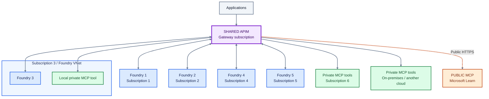
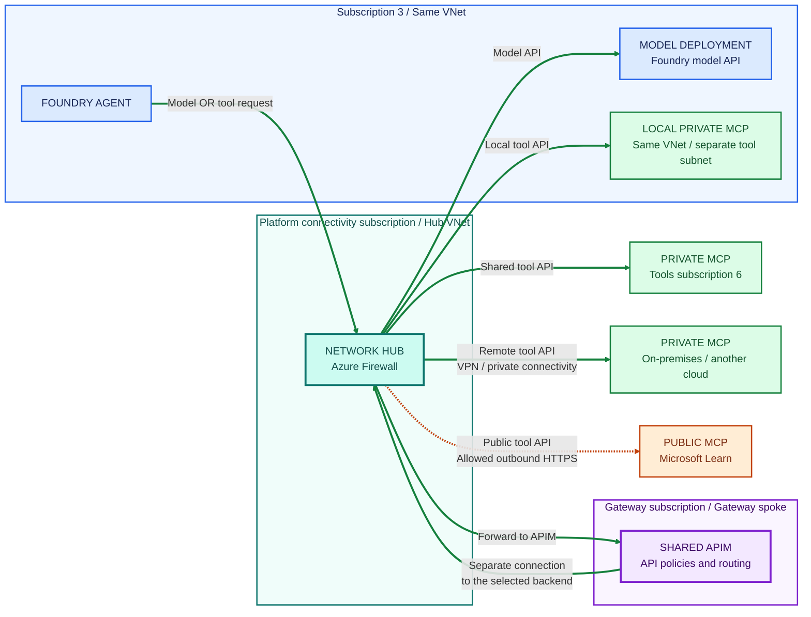
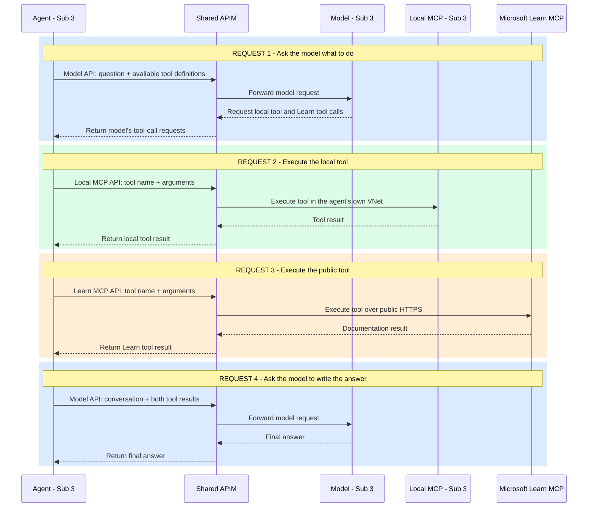

# AI Landing Zone Architecture

**One shared APIM gateway, five Foundry subscriptions, and a shared tools
subscription.** Agents access private and public tools through the same gateway.

An existing **platform connectivity subscription** provides the network hub,
firewall, DNS, and connections to remote networks. It is separate from the
seven AI subscriptions above.

These diagrams show the target architecture, not a validated deployment.

## Color key

| Color | Meaning |
|---|---|
| Purple | The single shared APIM gateway |
| Blue | Foundry instances and agents |
| Green | Private MCP tools |
| Orange | Public MCP tools, such as Microsoft Learn |
| Teal | Shared enterprise network hub and firewall |
| Gray | Applications |

## 1. Where everything lives

The subscription 3 group contains both Foundry and a local MCP tool in the same
VNet. Shared private tools live in subscription 6; APIM has its own subscription.
This is the **logical API view**: network and firewall hops are intentionally
omitted here and shown in diagram 2.

**Read it as:** applications call APIM to reach agents; agents call that same
APIM to reach tools or supported model APIs. The arrows show API relationships,
not automatic routing of every Foundry-internal call.

## 2. How traffic crosses the enterprise network

Follow one agent from subscription 3. Its local MCP tool shares its VNet, but
the API request still goes through the shared APIM. This view uses the
**hub-firewall routing option**, reflecting the Visio's hub and UDR labels,
rather than the previous direct-spoke-peering example.

**Solid green lines = private traffic. Dashed orange line = public HTTPS.**
Responses return over the same connections and are omitted.

Read the local-tool path as:

**Agent in subscription 3 -> hub firewall -> APIM -> hub firewall -> local
MCP tool in subscription 3.**

The hub appears once but is traversed twice: first on the agent's connection to
APIM, then on APIM's separate connection to the tool. **The firewall controls
network traffic; APIM controls API access and policies. Neither replaces the
other.** Each model request or tool invocation is a separate API request to
APIM. The outgoing lines show available destinations, not steps in a single
request. APIM selects the configured backend for that API; it does not turn a
model request into a tool call.

All workload spokes peer with the hub. Routes and firewall rules explicitly
enable traffic between them; peering alone is not transitive. DNS is supplied
centrally, as in the Visio. The other four Foundry spokes use the same pattern
and are omitted from this traffic view to keep it readable.

For Microsoft Learn, only the final outbound leg uses a public endpoint.
The APIM gateway remains privately accessible.

## 3. Model calls and tool calls are separate requests

This example shows one possible agent workflow: ask a model, execute two tools,
then ask the model to produce an answer using the results. Not every question
requires tools, and each invocation of a tool is a separate request.

**This is the target flow for agent code that supports APIM-configured model
and tool endpoints.** It does not imply that Foundry-managed internal model
calls automatically use APIM. The managed MCP path still needs validation.
Firewall hops are omitted here; diagram 2 shows the network path.

The **agent runtime** executes the tool calls requested by the model. APIM
routes and governs each request independently. MCP discovery, session setup,
and other protocol messages are omitted so this view focuses on the separate
model calls and tool invocations.

## Two deployment options, same diagrams

The purple box is always one APIM instance. Choose one networking configuration:

| Option | How callers reach APIM privately | How APIM reaches private backends |
|---|---|---|
| **Premium v2** | Injected gateway private IP | VNet injection |
| **Standard v2** | Inbound private endpoint; public gateway access disabled after establishing the private endpoint | Outbound VNet integration |

These are **alternatives**, not two APIM instances deployed together. Both
must be configured to use the selected hub-routing design. For Standard v2,
the private endpoint handles inbound traffic and the integration subnet handles
outbound traffic; they are distinct networking components.

## Details intentionally left out of the diagrams

- **Connectivity:** diagram 2 selects hub-firewall routing. This requires
  SKU-supported route configuration, symmetric return paths, and firewall
  rules, including private-endpoint routing configuration where applicable.
  Direct peering to the gateway spoke remains a simpler alternative when
  central inspection is not required, but is not the path shown here.
- **DNS and access:** private DNS, network rules, backend authorization, and
  client endpoint configuration are still required. Peering alone does not
  force requests through APIM or prevent bypass.
- **Managed agents:** the Foundry-managed MCP data-proxy-to-private-APIM path
  requires validation with tool discovery and invocation. The solid traffic
  arrows express the target flow, not verified runtime compatibility.
- **Model calls:** custom code can use APIM endpoints where supported.
  Foundry-managed internal model calls do not automatically traverse APIM.
- **Infrastructure:** Storage, Cosmos DB, and AI Search dependency traffic is
  outside the API-gateway flow.
- **Public tools:** private APIM ingress does not disable outbound internet
  access. Explicitly configure supported egress controls and MCP proxy behavior
  for the public backend.

## References

- [Foundry template 19: private network agent tools](https://github.com/microsoft-foundry/foundry-samples/tree/main/infrastructure/infrastructure-setup-bicep/19-private-network-agent-tools).
- [AI Landing Zones](https://azure.github.io/AI-Landing-Zones/).
- [AI Gateway / Citadel Governance Hub](https://github.com/Azure-Samples/ai-hub-gateway-solution-accelerator/).
- [APIM Premium v2 VNet injection](https://learn.microsoft.com/azure/api-management/inject-vnet-v2).
- [APIM inbound private endpoints](https://learn.microsoft.com/azure/api-management/private-endpoint).
- [Foundry public and private MCP endpoints](https://learn.microsoft.com/azure/foundry/agents/how-to/tools/model-context-protocol#public-and-private-mcp-server-endpoints).
